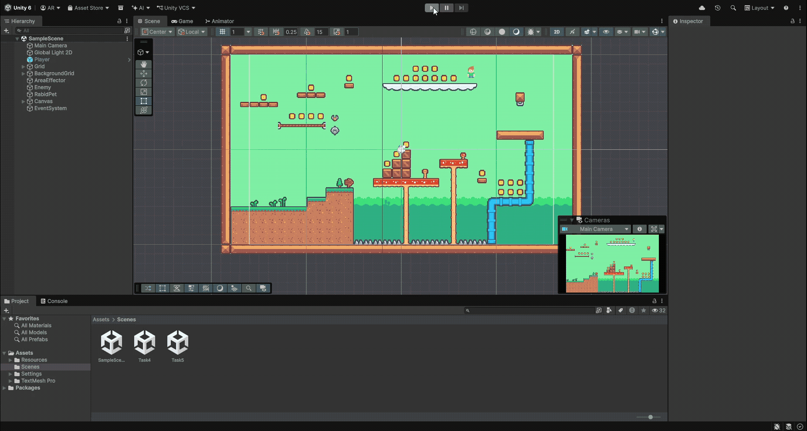
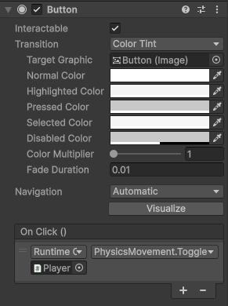
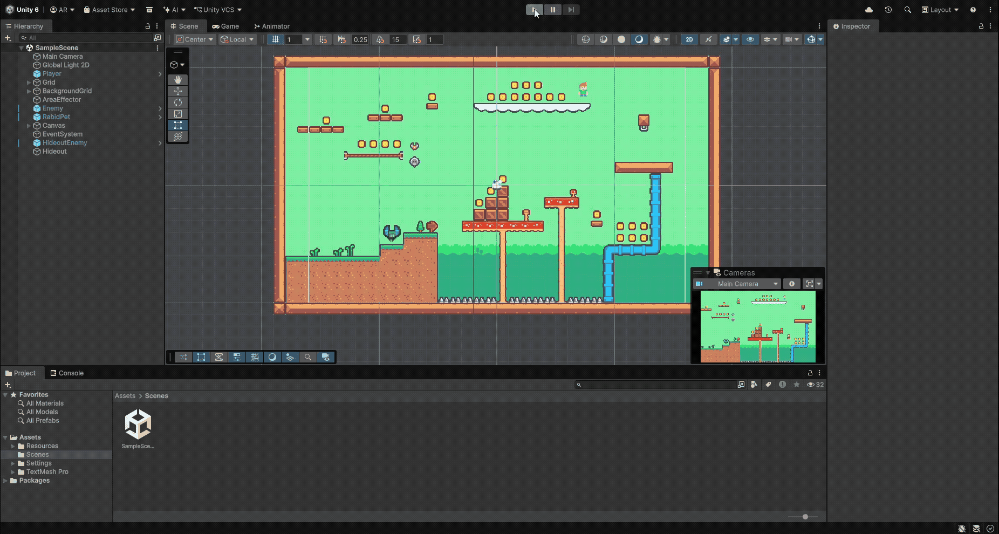
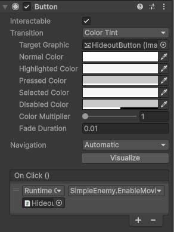
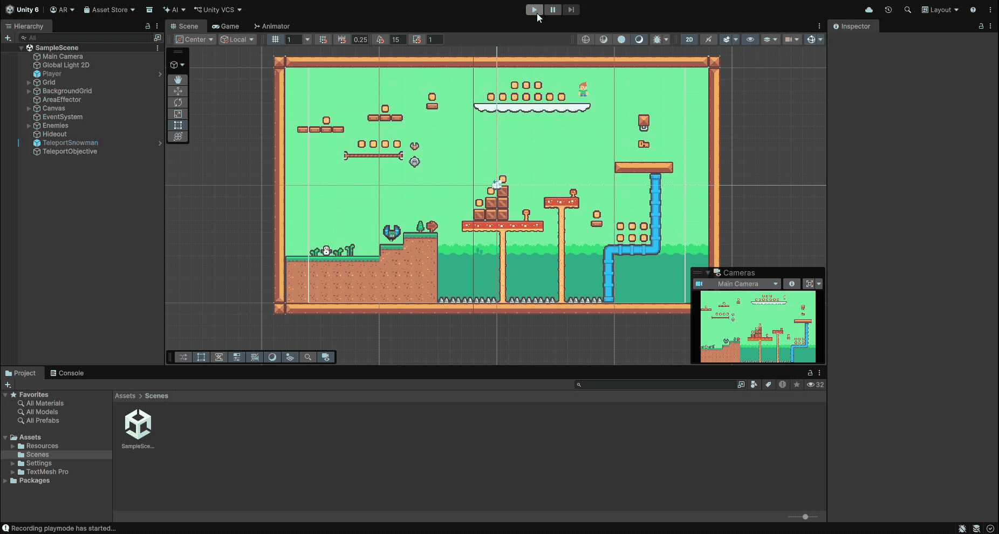

# FDV-2DTilemaps

*Fundamentos del Desarrollo de Videojuegos*' assignment: events programming exercises.


> In this activity we'll test the different ways to use events to send messages between objects in the Unity scene.\
> In Unity, you can define:
> - UI events
> - Events supported by the event system
> - Custom events, using delegates and C# events with the observer pattern.

## Table of contents
1. [Task 1](#task-1)
2. [Task 2](#task-2)
3. [Task 3](#task-3)

## Task 1

> Implement a User Interface (UI) in Unity 2D that meets the following requirements:
> - Add a button or selector that allows you to switch between two character movement modes: Stealth Mode (reduced speed) and Normal Mode (standard speed).
> - Show onscreen the amount of collected objects (e.g. coins or gems).
> - If a character collides with a special object or a 2D trap, its healthbar / healthtext in the UI must be reduced.



For this project, I started off of my [2D Tilemaps assigment's project](https://github.com/lara-ramos31/FDV-2DTilemaps). I started off by adding collectable coins to a `CollectableTilemap` (using the GameObject brush to paint coin prefabs), and a `HarmfulEnvTilemap` for the spikes that deal damage.

The main script to handle the game logic is [`PlayerGameplay`](Assets/Resources/Scripts/Player/PlayerGameplay.cs):
```c#
using UnityEngine;

public class PlayerGameplay : MonoBehaviour
{
    // Variables
    public const float maxHealth = 100;
    private float health = maxHealth;
    private float score = 0;

    // Events
    public delegate void FloatChanged(float val);
    public FloatChanged onHealthChange; // val is new health
    public FloatChanged onScoreChange; // val is new score

    void Start()
    {
        onHealthChange?.Invoke(health);
        onScoreChange?.Invoke(score);
    }

    public void ApplyDamage(float damage)
    {
        health -= damage;
        if (health < 0) { health = 0; }
        onHealthChange?.Invoke(health);
    }

    public void AddScore(float delta)
    {
        score += delta;
        if (score < 0) { score = 0; }
        onScoreChange?.Invoke(score);
    }

    void OnCollisionEnter2D(Collision2D collision)
    {
        switch(collision.gameObject.layer)
        {
            case 8: // harmful
                ApplyDamage(10);
                break;    
        }
    }

    void OnTriggerEnter2D(Collider2D other)
    {
        switch(other.gameObject.layer)
        {
            case 10: // collectable
                AddScore(50);
                Destroy(other.gameObject);
                break;
        }
    }
}
```

It manages both the score and the health of the player. Its `onHealthChange` and `onScoreChange` delegates are used to notify when either the health or the points change, respectively. It also exposes two methods, `ApplyDamage()` and `AddScore()` that automatically notify when used. For harmful environmental objects (the spikes), I use `OnCollisionEnter2D` to detect the collision and apply the corresponding damage, and `OnTriggerEnter2D` to add points when a coin is collected.

```c#
using UnityEngine;
using UnityEngine.UI;

[RequireComponent (typeof (Slider))]
public class HealthBar : MonoBehaviour
{
    public PlayerGameplay player;
    private Slider slider;

    void Awake()
    {
        slider = GetComponent<Slider>();
        player.onHealthChange += UpdateHealthbar;
    }

    void UpdateHealthbar(float health)
    {
        slider.value = health / PlayerGameplay.maxHealth;
    }
}
```

A custom `HealthBar` script is used to subscribe to the `onHealthChange` notifier, which simply updates the progress of the slider it is associated to.

```c#
using TMPro;
using UnityEngine;

[RequireComponent (typeof (TextMeshProUGUI))]
public class ScoreText : MonoBehaviour
{
    public PlayerGameplay player;
    private TextMeshProUGUI text;

    void Awake()
    {
        text = GetComponent<TextMeshProUGUI>();
        player.onScoreChange += UpdateScoreText;
    }

    void UpdateScoreText(float score)
    {
        text.text = "Points: " + ((int)score).ToString();
    }
}
```

Similarly, the `ScoreText` script subscribes to the `onScoreChange` notifier to update the "Points: " text in the UI.

```c#
public void ToggleStealth()
{
    isStealthy = !isStealthy;
    if (isStealthy) {
        hForce = stealthHForce;
    } else {
        hForce = baseHForce;
    }
}
```

Finally, I added a new `ToggleStealth()` function inside the [`PhysicsMovement`](Assets/Resources/Scripts/Player/PlayerMovement/PhysicsMovement.cs) script. This is the method that is called when the button's `onClick` event is triggered:

 

## Task 2

> Add a character to the scene that, when clicking on a specific UI element, moves progressively in the 2D space towards its "hideout" in the scene.



This change was very simple to implement. I added a new instance of the `Enemy` prefab, which uses the [`SimpleEnemy`](Assets/Resources/Scripts/Hostile/SimpleEnemy.cs) script from the [previous assignment](https://github.com/lara-ramos31/FDV-2DTilemaps). I simply added a new `shouldMove` to guard the movement logic, and a new `EnableMoving()` method to set it to `true` when the new button is clicked. The "Hideout" is just an empty GameObject placed in the scene.



## Task 3

> Add a collectable object that, when colliding with the player, triggers an event that makes another two objects in the scene perform the following tasks simultaneously:
> - Object A: starts to move smoothly towards the current position of the player.
> - Object B: moves immediately to a fixed point in the scene.



For this change, I created a new `Key` prefab with a `Collectable.Key` tag, and a new `onKeyCollected` delegate inside [`PlayerGameplay`](Assets/Resources/Scripts/Player/PlayerGameplay.cs). Then, I modified the Collectable checking logic to account for the new item:

```c#
void OnTriggerEnter2D(Collider2D other)
{
    switch(other.gameObject.layer)
    {
        case 10: // collectable
            if (other.gameObject.CompareTag("Collectable.Key")) {
                onKeyCollected?.Invoke();
            } else {
                AddScore(50);
            }
            Destroy(other.gameObject);
            break;
    }
}
```

To reuse existing code, I added an optional `PlayerGameplay` reference to [`SimpleEnemy`](Assets/Resources/Scripts/Hostile/SimpleEnemy.cs) so that it may act as Object A:

```c#
void Start()
{
    rb = GetComponent<Rigidbody2D>();
    renderer = GetComponent<SpriteRenderer>();
    if (objective == null) {
        Debug.LogError("Enemy: no objective set!");
    }
    if (player != null) {
        player.onKeyCollected += EnableMoving;
    }
}
```

Finally, for Object B I created a new [`TeleportObject`](Assets/Resources/Scripts/TeleportObject.cs) script, which simply moves to its objective when its method is `TeleportToObjective` method is invoked (when `onKeyCollected` is triggered):

```c#
using UnityEngine;

public class TeleportObject : MonoBehaviour
{
    public Transform objective;
    public PlayerGameplay player;

    void Start()
    {
        if (objective == null)
        {
            Debug.LogError("TeleportObject: no objective!");
        }
        if (player == null)
        {
            Debug.LogError("TeleportObject: no player!");
            return;
        }
        player.onKeyCollected += TeleportToObjective;
    }

    void TeleportToObjective()
    {
        transform.position = objective.position;
    }
}
```